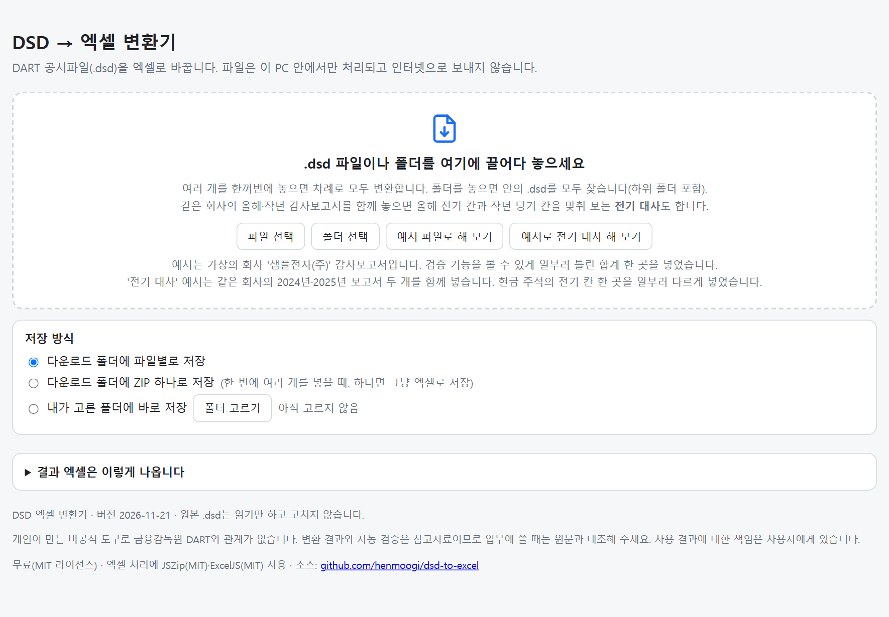
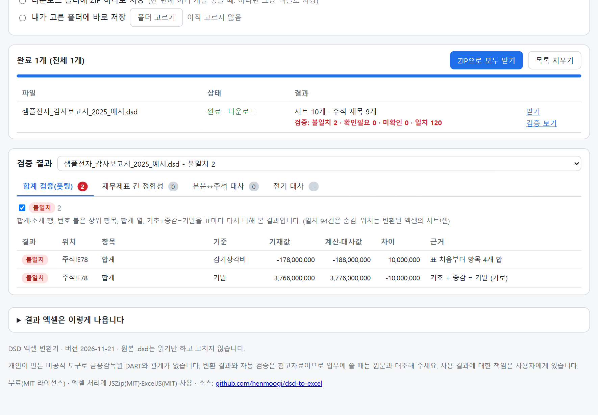
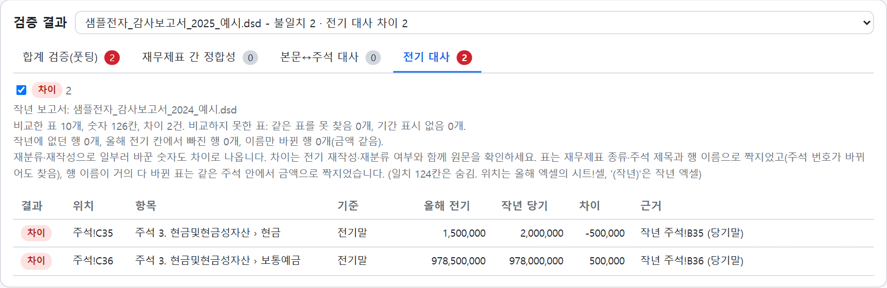
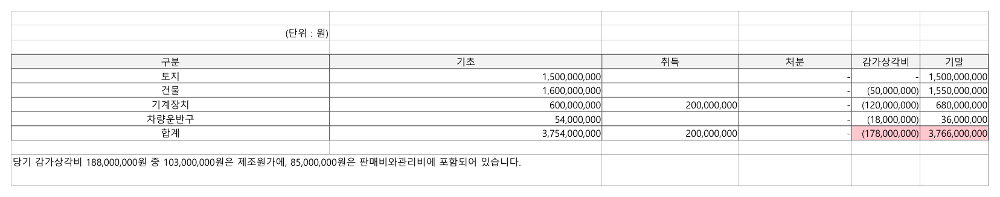

# DSD → 엑셀 변환기 (dsd-to-excel)

DART 공시파일(`.dsd`)을 엑셀(`.xlsx`)로 한 번에 바꾸고, 재무제표의 **합계·정합성을 자동으로 검사**하는 도구입니다. 같은 회사의 작년 보고서를 함께 넣으면 **전기 대사**(올해 전기 칸 = 작년 당기 칸)도 합니다.

👉 **바로 쓰기: https://henmoogi.github.io/dsd-to-excel/**

📝 소개 글(사용법·화면): [네이버 블로그](https://blog.naver.com/henmoogi/224433400390) · 휴대폰에서 .dsd를 열어 보려면 [DSD 뷰어](https://github.com/henmoogi/dsd-viewer)

- 설치할 것이 없습니다. 크롬·엣지·웨일 같은 브라우저만 있으면 됩니다.
- 파일은 **브라우저 안에서만** 처리됩니다. 서버로 보내지 않으며, 한 번 연 뒤에는 인터넷 없이도 동작합니다.
- 원본 `.dsd`는 읽기만 하고 고치지 않습니다.



## 할 수 있는 일

**1. 엑셀로 변환**
- 시트: 목차 · 검증 · 표지 · 감사보고서 · 재무상태표 · 손익계산서 · 자본변동표 · 현금흐름표 · 주석 · 외부감사실시내용
- 표의 병합 셀·테두리·머리글 음영을 원문대로 살립니다.
- 숫자는 계산할 수 있는 실제 숫자로 들어갑니다. `(1,234)`는 −1,234, `12.5%`는 0.125입니다.
- 목차 시트에서 시트와 주석 제목을 누르면 그 위치로 갑니다. 주석 시트는 주석 번호별로 접고 펼 수 있습니다.

**2. 여러 파일 한꺼번에**
- 파일 여러 개나 폴더를 끌어다 놓으면 차례로 모두 변환합니다(하위 폴더 포함).
- 저장 방식: 파일별 다운로드 / ZIP 하나로 / 내가 고른 폴더에 바로 저장(크롬·엣지)

**3. 자동 검증**

| 검사 | 내용 |
|---|---|
| 세로 합계 | 합계·총계·소계 행 = 위 항목의 합 |
| 상위 항목 합계 | Ⅰ. (1) 같은 번호 행 = 바로 아래 하위 항목의 합 |
| 가로 합계 | 합계 열 = 왼쪽 열의 합 |
| 증감 | 기초 + 증감 = 기말 (행 방향·열 방향) |
| 재무제표 간 | 자산총계 = 부채와자본총계, 당기순이익·기말현금·자본총계가 재무제표끼리 같은지 |
| 본문 ↔ 주석 | 재무제표 과목의 `(주석6)` 금액이 6번 주석에 있는지 |

결과는 불일치 · 확인필요 · 단수차이 · 미확인 · 일치로 나뉩니다. 화면의 **검증 결과** 패널과 엑셀의 **검증** 시트에 나오고, 불일치 셀은 엑셀에서 연한 빨강으로 칠해집니다.



**4. 전기 대사** (v2026.11.21 추가)
- 같은 회사의 올해·작년 감사보고서를 **한 번에** 넣으면(함께 끌어다 놓기·함께 선택·같은 폴더) 회사 이름과 기간으로 짝을 짓습니다.
- 올해 보고서의 **전기** 칸과 작년 보고서의 **당기** 칸을 표마다 비교합니다. 재무상태표·손익계산서·자본변동표·현금흐름표와 주석 표가 대상입니다.
- 표의 기간은 머리글(당기·전기, 제 N(당)기, 기말일), 자본변동표의 '(전기초)~(전기말)' 행, 표 앞의 '<당기>'·'(전기)'·'당기말 현재 …' 같은 글로 가립니다.
- 표는 재무제표 종류·주석 제목과 행 이름으로 짝짓습니다. 주석 번호가 바뀌어도 찾고, 거래 상대방 이름이 모두 바뀐 표는 같은 주석 안에서 금액으로 짝짓습니다.
- 결과: 비교한 표·숫자 칸·차이 건수, 비교하지 못한 표(같은 표를 못 찾음 / 기간 표시 없음), 작년에 없던 행, 올해 전기 칸에서 빠진 행, 이름만 바뀐 행(금액 같음). 화면의 **전기 대사** 탭과 올해 파일 **검증** 시트 아래쪽에 나오고, 차이 칸은 엑셀에서 연한 빨강으로 칠해집니다.
- 재분류·재작성으로 일부러 바꾼 숫자도 차이로 나옵니다. 반기·분기 검토보고서는 짝짓지 않습니다.



## 예시 파일로 해 보기

가진 `.dsd`가 없으면 화면의 **[예시 파일로 해 보기]** 단추를 누르세요. 가상의 회사 '샘플전자(주)'의 감사보고서로 변환과 검증을 해 볼 수 있습니다. 검증 기능을 보여 주려고 유형자산 주석 표의 합계 한 곳을 일부러 틀리게 넣어 두었습니다.

**[예시로 전기 대사 해 보기]**는 같은 가상 회사의 2024년·2025년 보고서 두 개를 함께 넣습니다. 현금및현금성자산 주석에서 2025년 보고서의 전기말 현금·보통예금 구분을 2024년 보고서와 다르게(합계는 같게) 넣어 두어, 전기 대사 차이 2건이 나옵니다.



## 내려받아 쓰기

인터넷이 막힌 PC에서 쓰려면 [릴리스](https://github.com/henmoogi/dsd-to-excel/releases/latest)에서 `dsd-to-excel_v<버전>.html` 하나만 받아 더블클릭하면 됩니다. 함께 있는 `SHA256SUMS.txt`로 원본인지 확인할 수 있습니다.

```powershell
Get-FileHash .\dsd-to-excel_v2026.11.21.html -Algorithm SHA256
```

## 알아 두기

- 감사보고서와 반기검토보고서로 시험했습니다. 연결재무제표·사업보고서 등 다른 문서는 아직 충분히 시험하지 않았습니다.
- 자동 검증은 표의 모양을 보고 판단합니다. 서식이 특이한 표는 잘못 판단할 수 있으니 '불일치'·'확인필요'는 반드시 원문과 대조해 주세요. '미확인'은 본문 금액을 주석에서 찾지 못해 대사를 못 한 항목입니다.
- 엑셀 → DSD 역변환은 하지 않습니다.
- 전기 대사는 같은 문서 종류(예: 감사보고서끼리)만 짝짓습니다. 작년 파일 후보가 둘 이상이면 어느 것과 비교할지 정할 수 없어 하지 않고 안내만 합니다. 표와 앞 글에 당기·전기 표시가 없는 표는 '기간 표시 없음'으로 남깁니다.

## 바뀐 점

- **v2026.11.21**: 전기 대사 추가(같은 회사 두 해 보고서를 함께 넣을 때), [예시로 전기 대사 해 보기] 단추, 사이트 아이콘. 검증 근거 문구의 긴 줄표를 하이픈으로 바꿈(검사 결과는 같음).
- **v2026.10.06**: 첫 공개

## 면책

개인이 만든 **비공식** 도구로 금융감독원 DART와 관계가 없습니다. 변환 결과와 자동 검증은 참고자료이며, 업무에 쓸 때는 원문과 대조해 주세요. 사용 결과에 대한 책임은 사용자에게 있습니다.

## 라이선스

[MIT](LICENSE) - 자유롭게 쓰고 고치고 나눌 수 있습니다. 사용한 라이브러리는 [THIRD_PARTY_NOTICES.md](THIRD_PARTY_NOTICES.md)를 보세요.

## 직접 고쳐서 빌드하기

변환 규칙과 묶음 변환(전기 대사 짝짓기)은 `src/dsd-core.js`, 검증·전기 대사 규칙은 `src/dsd-checks.js`, 화면은 `src/template.html`에 있습니다.

```bash
node src/build.cjs        # src를 묶어 DSD엑셀변환.html 한 파일로 만든다
```

예시 파일은 `python src/sample/make_sample_dsd.py <파일이름>`으로 다시 만들 수 있습니다(`--no-error`를 붙이면 일부러 틀린 곳 없이, `--prior`를 붙이면 작년(2024년) 보고서).
